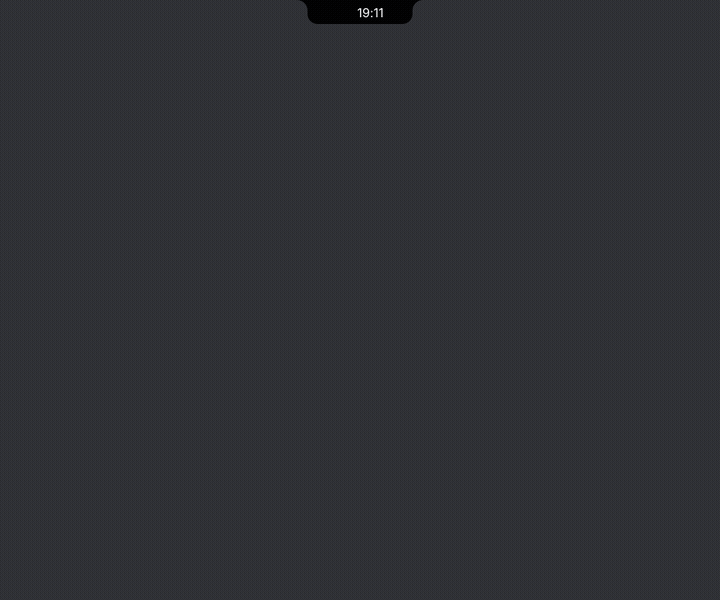

# Visus

A tiny always-on-top pill at the top of your screen that shows what matters at a glance and gets
out of the way. Native Rust, no web engine, near-zero CPU when idle.

## Features

- **Music**: any player (Windows media sessions / Linux MPRIS), album art, transport controls, synced lyrics.
- **Focus timer**: presets and steppers; the pill ring counts down. **To-do** with `@14:30` reminders.
- **Stats** (CPU, memory, network), **Calendar**, **Weather** (search your city), **File shelf** (drop files on the pill).
- **Launcher**: Alt+Space or Ctrl+Alt+Space (Windows) or `visus --toggle-palette` (Linux, bind it in your compositor). Searches apps
  with icons, runs Visus commands, does maths, opens URLs, searches the web, takes screenshots.
- **Alerts**: charger, Caps Lock, volume, keyboard language, Wi-Fi, reminders.
- **Game HUD**: Pills, Bars, Card, or Compact. CPU/GPU load, temperatures, and RAM where supported;
  Card and Compact show FPS/frame time when a source is available. Linux reads active MangoHud logs.
- **Idle eye** that blinks, looks around and follows your cursor. Classic, Sauron, Cat, or Robot styles.
- **Expanding settings** (gear in the open pill): the notch inflates into sidebar sections for appearance, clock, mascot, behavior,
  gaming, integrations, updates, and alerts. Live previews, independent closed/header clock sizes, sliders and
  typed values, explicit style choices, and per-section reset. Close or Escape collapses it back into
  the pill. Changes save automatically.

## Customization

| Section | Available controls |
| --- | --- |
| Appearance | Attached/Floating/Soft styles, independent closed/open sizes, padding, accent modes and fixed colors, battery/visualizer/minimal toggles, network units |
| Clock | Classic/Flip/LED, closed clock size (12-32 px), header clock size (16-30 px), battery ring size (12-32 px), 12/24-hour time, optional dim clock |
| Mascot | Enable, four styles, idle delay, expressions, iris/eye colors, animation intensity, reduced motion, reaction guide |
| Behavior | Fullscreen hiding, quiet alerts, clipboard history, focus duration, start at login, hover-open/close delays |
| Gaming | HUD on/off and Pills/Bars/Card/Compact layout selection |
| Integrations | Weather city, calendar URL/file, file-manager command, launcher folders |
| Updates | Automatic checks, manual check, install an available update |
| Alerts | Independent switches for power, network, headphones, controllers, downloads, timer/tasks/meetings, updates, and control HUDs |

Closed pill size and open tabbed UI size are independent, with a smooth transition between them.
Minimal mode previews only the thin notch; the visualizer preview uses sample playback and its hint
explains that live bars require media playback. Clock sizes can be changed independently. Larger clocks grow the pill's minimum
bounds to avoid overlap. Style selectors and switches apply immediately; numeric sliders also accept
typed values. Settings are saved locally, with per-section reset and live closed/header/mascot/game previews.
Hiding the battery ring reclaims its space and centers an otherwise standalone clock. Editing a closed
or header control automatically selects that preview view. Clock brightness stays full by default;
enable Dim clock for a softer clock in both views.
Battery ring size is independent of clock size; its status icon scales with the ring and the pill grows
to keep it inside. The timer ring is unaffected. Editing battery size selects the closed preview.
The idle pill fits the measured clock width with 16 px outer padding. Clock settings also include a
Ring-clock gap slider (4-32 px, default 12 px); this spacing is removed when no ring is visible.
The settings preview uses the machine's live battery percentage and charging status. Enable
Match ring to clock to align the ring's outer height with the clock face; disable it for manual sizing.
Longer sections show a scrollbar and a clickable More below cue. The Mascot section includes a
style-specific reaction guide below its controls, with idle-expression previews and event meanings.
Robot glitch/flicker and pink pulse are decorative idle moods, not app errors or hardware warnings.
Settings sliders and selection highlights follow the live media theme while the surface stays black.
Appearance includes an Attached / Floating / Soft pill-style selector. Floating leaves a 12 px gap above
the capsule; Soft removes the flared top edges and uses broader lower corners. Previews and expanded
settings use the selected silhouette, and pointer input follows the floating offset.
Appearance also has Media/Mascot/Fixed accent modes, fixed color swatches, and outer padding (8-32 px).
Mascot includes animation intensity (0.3-1.5x) and Reduced motion for static mascot effects and immediate
size transitions. Behavior has separate hover-open (0-1000 ms) and hover-close (50-2000 ms) delays.
The Alerts section independently controls power, network, headphones, controllers, completed downloads,
timer, tasks, meetings, updates, and keyboard/audio HUD notifications. Quiet mode remains an additional
filter; explicitly disabled timer/task notifications stay disabled even though Quiet normally allows them.

### Cloud Gaming Telemetry

Visus adapts the collection strategy used in SalsaStats without modifying or depending on that app.
Windows tries NVIDIA's NVAPI driver interface, `nvidia-smi`, then bounded WMI/CIM GPU performance
counters. GPU load, temperature, and dedicated VRAM are optional and independent; unavailable
temperature no longer hides a valid GPU reading. Transient collection failures are retried.

On GeForce NOW/SalsaNow, run Visus **inside the Windows cloud rig** to read that rig's GPU and VRAM.
A Visus instance on your local streaming client can only measure the local machine. Provider driver
and permission restrictions may still hide individual counters; Visus does not invent missing values.
Pills/Bars/Card display VRAM when available; Compact remains the FPS-only layout. Linux keeps NVIDIA
and AMD collection with dedicated VRAM where exposed. Real cloud-rig validation is still required.
Sauron has molten trails and lid flames clipped inside the notch. Cat has breathing, slow blinks and
visual purring; Robot has a gentle bob and reply-light pulses. These effects are silent. Expressions
controls the extra purr/reply flourishes; awake animated styles redraw at up to 20 FPS.

Not every visual dimension is independently adjustable: font family, page text sizes, spacing, button
dimensions, and individual visualizer geometry remain fixed. Hardware readings, startup integration,
and update installation depend on the platform and permissions.



## Install

Download from [Releases](https://github.com/DevDad-Main/Visus/releases):

- Windows: run `Visus-Setup.exe` (per-user install, no admin needed; optional start at login and desktop shortcut; uninstall from the tray menu or Settings > Apps). Or unzip `Visus-windows-x64.zip` and run `Visus.exe`. If SmartScreen shows a notice, choose More info > Run anyway.
- Linux (Wayland, wlr-layer-shell compositors such as Hyprland/Sway): extract `Visus-linux-x64.tar.gz`, run `visus/visus`.
  Hyprland launcher key: `bind = SUPER, space, exec, /path/to/visus --toggle-palette`.

Launcher tips: `note <text>` saves a note, `cal <ics link>` sets a calendar, `fm <command>` sets your file manager (e.g. `fm thunar {path}`, `fm "C:\\Tools\\Explorer++\\Explorer++.exe" {path}`, `fm foot -e yazi {path}`; `fm default` resets), and typing part of a window title switches to it.

Settings, to-dos and the shelf live in `%APPDATA%\visus` (Windows) or `~/.config/visus` (Linux).
Linux in-pill updates verify the release archive's SHA-256, replace the executable in a user-writable
installation, and restart Visus. System-owned installations must be updated with their package manager.
Versions through v1.11.0 only open the release page on Linux and require a manual upgrade before this
update path is available. The Linux updater requires x86_64 and `tar`.
Visus makes network requests for lyrics (LRCLIB), missing cover art, weather and city search (Open-Meteo),
calendar URLs you configure, and update checks/downloads. Automatic update checks can be disabled in
Settings. No accounts, no analytics.

## Build

### Local Development

On Linux, stop the installed Visus instance, then run `bash tools/dev-watch.sh` or use the VS Code
task **Visus: Development Watch**. Requires `inotify-tools` (`inotifywait`). Saving Rust source,
crate assets, or Cargo manifests rebuilds the debug app and restarts it automatically. Failed builds
leave the last working instance running. Stop the task with Ctrl+C to stop the watcher and its app.

Watch mode uses the optimized `dev-fast` profile, keeping incremental builds and debug information
without the slow unoptimized software renderer. Its first build takes longer while dependencies compile.
This is rebuild-and-restart, not state-preserving hot reload. Settings persist, but transient state
resets on restart. The development executable stays in `target/dev-fast`; the installed release at
`~/.local/bin/visus` is unchanged. Do not run both copies at once because Visus is single-instance.

```
cargo run -p visus-app            # run
cargo test                        # tests
visus-app --snapshot settings out.png   # render a page headlessly
visus-app --settings-preview clock.png Clock
visus-app --settings-preview header.png Clock:header
visus-app --settings-morph-preview /tmp/settings-frame
```

Settings text fields accept Enter to commit and Escape to cancel. Launcher folders are separated by
semicolons; an empty optional field restores its default behavior.

### Extending Settings

Register sections and fields in `crates/visus-app/src/settings_ui.rs` (`SECTIONS`). The registry owns
sidebar navigation and row layout; switches, numeric sliders with typed values, style choices, color
swatches, and text fields share rendering and input handling. Add persistent fields and defaults to
`visus-core::Settings`. Registry tests verify that controls bind to serialized settings keys.

`settings_surface.rs` connects the modular UI directly to the notch's input and action handling.
Settings expands from the pill's spring-animated shape and reverses on close, sharing the same renderer
and controls on Windows/X11 and Linux layer-shell. No extra window or companion process is opened.

Release builds are code-signed when `WINDOWS_CERT_PFX` (a base64-encoded PFX) and
`WINDOWS_CERT_PASSWORD` are set as repository secrets. Both `Visus.exe` and `Visus-Setup.exe`
(including its uninstaller) are signed; without the secrets the workflow still produces unsigned
artifacts.
